# [📈 Live Status](https://wokabout.github.io/pg-upptime): <!--live status--> **🟧 Partial outage**

This repository contains the open-source uptime monitor and status page for [wokabout](https://wokabout.github.io/pg-upptime), powered by [Upptime](https://github.com/upptime/upptime).

With [Upptime](https://upptime.js.org), you can get your own unlimited and free uptime monitor and status page, powered entirely by a GitHub repository. We use [Issues](https://github.com/wokabout/pg-upptime/issues) as incident reports, [Actions](https://github.com/wokabout/pg-upptime/actions) as uptime monitors, and [Pages](https://wokabout.github.io/pg-upptime) for the status page.

<!--start: status pages-->
<!-- This summary is generated by Upptime (https://github.com/upptime/upptime) -->
<!-- Do not edit this manually, your changes will be overwritten -->
<!-- prettier-ignore -->
| URL | Status | History | Response Time | Uptime |
| --- | ------ | ------- | ------------- | ------ |
|  [PNG-DNS-UOT](202.1.32.125) | 🟩 Up | [png-dns-uot.yml](https://github.com/wokabout/pg-upptime/commits/HEAD/history/png-dns-uot.yml) | 

 0ms
     
 | 

<a href="https://wokabout.github.io/pg-upptime/history/png-dns-uot">100.00%</a>
    

|  [PNG-DNS-Gransy1](185.28.194.194) | 🟩 Up | [png-dns-gransy1.yml](https://github.com/wokabout/pg-upptime/commits/HEAD/history/png-dns-gransy1.yml) | 

 24ms
     
 | 

<a href="https://wokabout.github.io/pg-upptime/history/png-dns-gransy1">100.00%</a>
    

|  [PNG-DNS-Gransy2](185.38.108.108) | 🟩 Up | [png-dns-gransy2.yml](https://github.com/wokabout/pg-upptime/commits/HEAD/history/png-dns-gransy2.yml) | 

 24ms
     
 | 

<a href="https://wokabout.github.io/pg-upptime/history/png-dns-gransy2">100.00%</a>
    

|  [PNG-DNS-PCH](204.61.216.152) | 🟩 Up | [png-dns-pch.yml](https://github.com/wokabout/pg-upptime/commits/HEAD/history/png-dns-pch.yml) | 

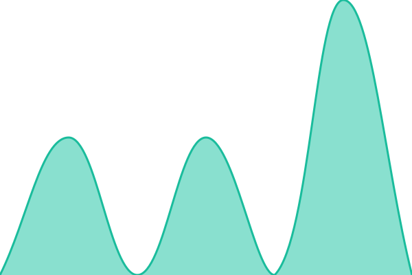 2ms
     
 | 

<a href="https://wokabout.github.io/pg-upptime/history/png-dns-pch">100.00%</a>
    

|  [PNG-Government-Info](https://info.gov.pg/) | 🟩 Up | [png-government-info.yml](https://github.com/wokabout/pg-upptime/commits/HEAD/history/png-government-info.yml) | 

 422ms
     
 | 

<a href="https://wokabout.github.io/pg-upptime/history/png-government-info">100.00%</a>
    

|  [PNG-PMNEC](https://pmnec.gov.pg/) | 🟩 Up | [png-pmnec.yml](https://github.com/wokabout/pg-upptime/commits/HEAD/history/png-pmnec.yml) | 

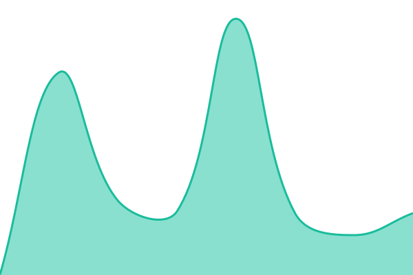 202ms
     
 | 

<a href="https://wokabout.github.io/pg-upptime/history/png-pmnec">100.00%</a>
    

|  [PNG-Finance](https://www.finance.gov.pg/) | 🟩 Up | [png-finance.yml](https://github.com/wokabout/pg-upptime/commits/HEAD/history/png-finance.yml) | 

 2412ms
     
 | 

<a href="https://wokabout.github.io/pg-upptime/history/png-finance">87.63%</a>
    

|  [PNG-IRC](https://irc.gov.pg/) | 🟩 Up | [png-irc.yml](https://github.com/wokabout/pg-upptime/commits/HEAD/history/png-irc.yml) | 

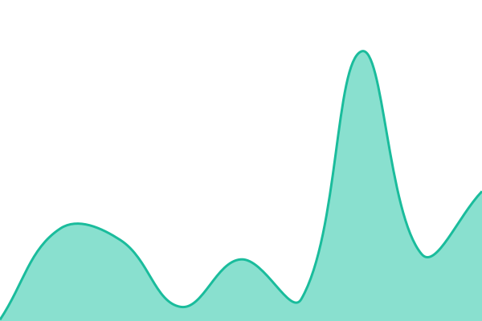 151ms
     
 | 

<a href="https://wokabout.github.io/pg-upptime/history/png-irc">100.00%</a>
    

|  [PNG-Justice-AG](https://www.justice.gov.pg/) | 🟩 Up | [png-justice-ag.yml](https://github.com/wokabout/pg-upptime/commits/HEAD/history/png-justice-ag.yml) | 

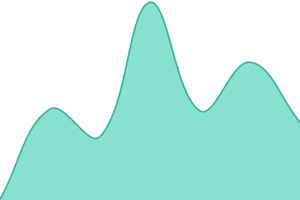 202ms
     
 | 

<a href="https://wokabout.github.io/pg-upptime/history/png-justice-ag">100.00%</a>
    

|  [PNG-Health](https://www.health.gov.pg/) | 🟩 Up | [png-health.yml](https://github.com/wokabout/pg-upptime/commits/HEAD/history/png-health.yml) | 

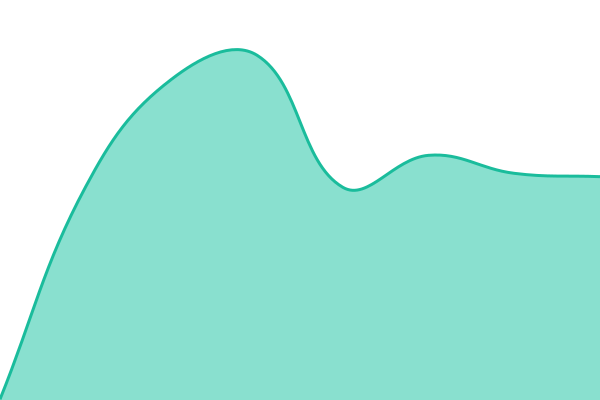 400ms
     
 | 

<a href="https://wokabout.github.io/pg-upptime/history/png-health">100.00%</a>
    

|  [PNG-MET](https://www.pngmet.gov.pg/) | 🟩 Up | [png-met.yml](https://github.com/wokabout/pg-upptime/commits/HEAD/history/png-met.yml) | 

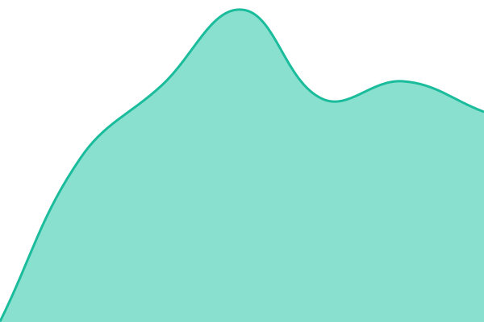 1238ms
     
 | 

<a href="https://wokabout.github.io/pg-upptime/history/png-met">100.00%</a>
    

|  [PNG-NDC](https://www.pngndc.gov.pg/) | 🟩 Up | [png-ndc.yml](https://github.com/wokabout/pg-upptime/commits/HEAD/history/png-ndc.yml) | 

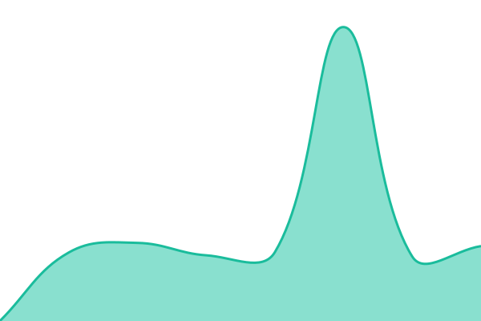 1021ms
     
 | 

<a href="https://wokabout.github.io/pg-upptime/history/png-ndc">98.99%</a>
    

|  [PNG-DICT-GovCloud](https://www.ict.gov.pg/government-cloud-platform-2/) | 🟩 Up | [png-dict-gov-cloud.yml](https://github.com/wokabout/pg-upptime/commits/HEAD/history/png-dict-gov-cloud.yml) | 

 673ms
     
 | 

<a href="https://wokabout.github.io/pg-upptime/history/png-dict-gov-cloud">100.00%</a>
    

|  [PNG-BPNG](https://www.bankpng.gov.pg/) | 🟥 Down | [png-bpng.yml](https://github.com/wokabout/pg-upptime/commits/HEAD/history/png-bpng.yml) | 

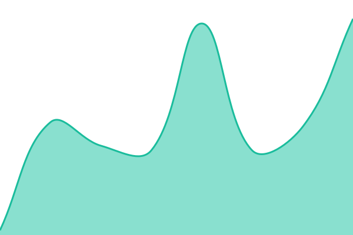 26ms
     
 | 

<a href="https://wokabout.github.io/pg-upptime/history/png-bpng">100.00%</a>
    

|  [PNG-BSP](https://www.bsp.com.pg/) | 🟩 Up | [png-bsp.yml](https://github.com/wokabout/pg-upptime/commits/HEAD/history/png-bsp.yml) | 

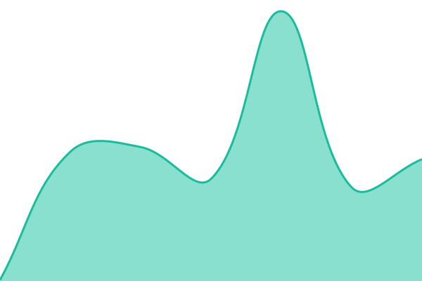 153ms
     
 | 

<a href="https://wokabout.github.io/pg-upptime/history/png-bsp">100.00%</a>
    

|  [PNG-BSP-OnlineBanking](https://www.bsp.com.pg/personal-banking/ways-to-bank/online-banking/) | 🟩 Up | [png-bsp-online-banking.yml](https://github.com/wokabout/pg-upptime/commits/HEAD/history/png-bsp-online-banking.yml) | 

 298ms
     
 | 

<a href="https://wokabout.github.io/pg-upptime/history/png-bsp-online-banking">100.00%</a>
    

|  [PNG-KinaBank](https://www.kinabank.com.pg/) | 🟩 Up | [png-kina-bank.yml](https://github.com/wokabout/pg-upptime/commits/HEAD/history/png-kina-bank.yml) | 

 231ms
     
 | 

<a href="https://wokabout.github.io/pg-upptime/history/png-kina-bank">100.00%</a>
    

|  [PNG-Kina-Personal-DigiBank](https://personal.kinabank.com.pg/drb/#/drb/login) | 🟩 Up | [png-kina-personal-digi-bank.yml](https://github.com/wokabout/pg-upptime/commits/HEAD/history/png-kina-personal-digi-bank.yml) | 

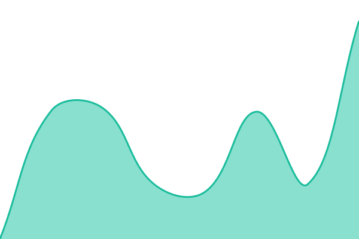 600ms
     
 | 

<a href="https://wokabout.github.io/pg-upptime/history/png-kina-personal-digi-bank">100.00%</a>
    

|  [PNG-Kina-PrivateBanking](https://digital.kinabank.com.pg/privatebanking/) | 🟩 Up | [png-kina-private-banking.yml](https://github.com/wokabout/pg-upptime/commits/HEAD/history/png-kina-private-banking.yml) | 

 678ms
     
 | 

<a href="https://wokabout.github.io/pg-upptime/history/png-kina-private-banking">100.00%</a>
    

|  [PNG-Kina-Payments](https://payments.kinabank.com.pg/Account/Login.aspx) | 🟩 Up | [png-kina-payments.yml](https://github.com/wokabout/pg-upptime/commits/HEAD/history/png-kina-payments.yml) | 

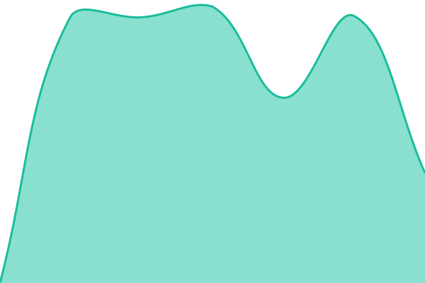 706ms
     
 | 

<a href="https://wokabout.github.io/pg-upptime/history/png-kina-payments">100.00%</a>
    

|  [PNG-Kina-Corporate-User](https://corporate.kinabank.com.pg/CorpUser/) | 🟩 Up | [png-kina-corporate-user.yml](https://github.com/wokabout/pg-upptime/commits/HEAD/history/png-kina-corporate-user.yml) | 

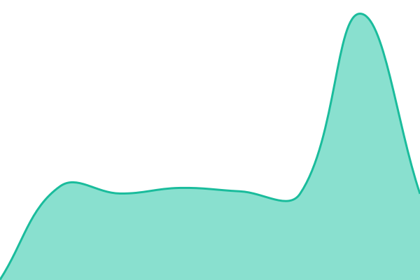 438ms
     
 | 

<a href="https://wokabout.github.io/pg-upptime/history/png-kina-corporate-user">100.00%</a>
    

|  [PNG-Kina-Corporate-Admin](https://corporate.kinabank.com.pg/CorpAdmin/) | 🟩 Up | [png-kina-corporate-admin.yml](https://github.com/wokabout/pg-upptime/commits/HEAD/history/png-kina-corporate-admin.yml) | 

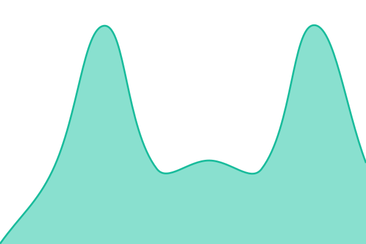 440ms
     
 | 

<a href="https://wokabout.github.io/pg-upptime/history/png-kina-corporate-admin">100.00%</a>
    

|  [PNG-Kina-PEI-Beta](https://www.peibeta.com/) | 🟩 Up | [png-kina-pei-beta.yml](https://github.com/wokabout/pg-upptime/commits/HEAD/history/png-kina-pei-beta.yml) | 

 863ms
     
 | 

<a href="https://wokabout.github.io/pg-upptime/history/png-kina-pei-beta">100.00%</a>
    

|  [PNG-Westpac](https://www.westpac.com.pg/) | 🟩 Up | [png-westpac.yml](https://github.com/wokabout/pg-upptime/commits/HEAD/history/png-westpac.yml) | 

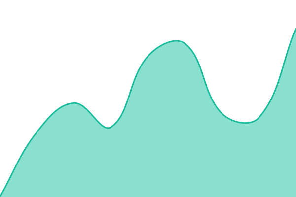 370ms
     
 | 

<a href="https://wokabout.github.io/pg-upptime/history/png-westpac">100.00%</a>
    

|  [PNG-Westpac-OnlineBanking](https://www.westpac.com.pg/personal/services/online-banking/) | 🟩 Up | [png-westpac-online-banking.yml](https://github.com/wokabout/pg-upptime/commits/HEAD/history/png-westpac-online-banking.yml) | 

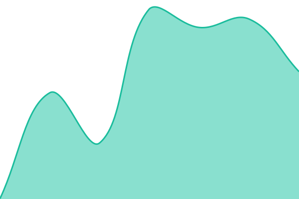 1476ms
     
 | 

<a href="https://wokabout.github.io/pg-upptime/history/png-westpac-online-banking">100.00%</a>
    

|  [PNG-NASFUND](https://www.nasfund.com.pg/) | 🟩 Up | [png-nasfund.yml](https://github.com/wokabout/pg-upptime/commits/HEAD/history/png-nasfund.yml) | 

 1271ms
     
 | 

<a href="https://wokabout.github.io/pg-upptime/history/png-nasfund">100.00%</a>
    

|  [PNG-NASFUND-eBranch](https://www.nasfund.com.pg/services/e-branch) | 🟩 Up | [png-nasfund-e-branch.yml](https://github.com/wokabout/pg-upptime/commits/HEAD/history/png-nasfund-e-branch.yml) | 

 1104ms
     
 | 

<a href="https://wokabout.github.io/pg-upptime/history/png-nasfund-e-branch">100.00%</a>
    

|  [PNG-NambawanSuper](https://www.nambawansuper.com.pg/) | 🟩 Up | [png-nambawan-super.yml](https://github.com/wokabout/pg-upptime/commits/HEAD/history/png-nambawan-super.yml) | 

 923ms
     
 | 

<a href="https://wokabout.github.io/pg-upptime/history/png-nambawan-super">100.00%</a>
    

|  [PNG-NambawanSuper-Members](https://www.nambawansuper.com.pg/members/avoid-the-line-get-online) | 🟩 Up | [png-nambawan-super-members.yml](https://github.com/wokabout/pg-upptime/commits/HEAD/history/png-nambawan-super-members.yml) | 

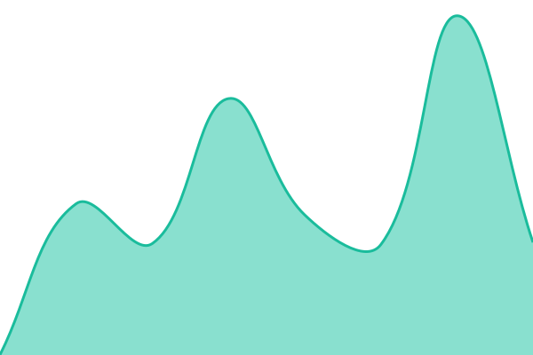 923ms
     
 | 

<a href="https://wokabout.github.io/pg-upptime/history/png-nambawan-super-members">100.00%</a>
    

|  [PNG-Customs](https://www.customs.gov.pg/) | 🟩 Up | [png-customs.yml](https://github.com/wokabout/pg-upptime/commits/HEAD/history/png-customs.yml) | 

 505ms
     
 | 

<a href="https://wokabout.github.io/pg-upptime/history/png-customs">100.00%</a>
    

|  [PNG-Customs-ASYCUDA](https://www.customs.gov.pg/trade/asycuda) | 🟩 Up | [png-customs-asycuda.yml](https://github.com/wokabout/pg-upptime/commits/HEAD/history/png-customs-asycuda.yml) | 

 552ms
     
 | 

<a href="https://wokabout.github.io/pg-upptime/history/png-customs-asycuda">100.00%</a>
    

|  [PNG-Power](https://www.pngpower.com.pg/) | 🟩 Up | [png-power.yml](https://github.com/wokabout/pg-upptime/commits/HEAD/history/png-power.yml) | 

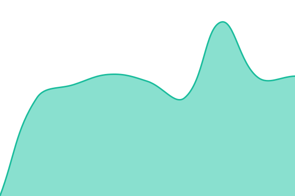 633ms
     
 | 

<a href="https://wokabout.github.io/pg-upptime/history/png-power">100.00%</a>
    

|  [PNG-Power-NetworkMap](https://www.pngpower.com.pg/network-map) | 🟩 Up | [png-power-network-map.yml](https://github.com/wokabout/pg-upptime/commits/HEAD/history/png-power-network-map.yml) | 

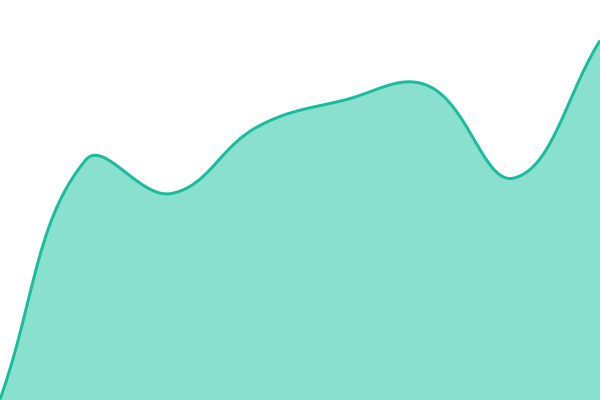 633ms
     
 | 

<a href="https://wokabout.github.io/pg-upptime/history/png-power-network-map">100.00%</a>
    

|  [PNG-Telikom](https://www.telikom.com.pg/) | 🟩 Up | [png-telikom.yml](https://github.com/wokabout/pg-upptime/commits/HEAD/history/png-telikom.yml) | 

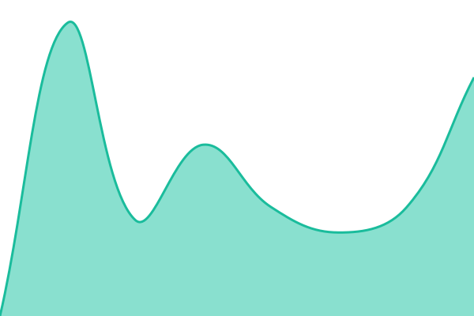 4055ms
     
 | 

<a href="https://wokabout.github.io/pg-upptime/history/png-telikom">99.00%</a>
    

|  [PNG-Digicel](https://www.digicelpacific.com/mobile/pg) | 🟩 Up | [png-digicel.yml](https://github.com/wokabout/pg-upptime/commits/HEAD/history/png-digicel.yml) | 

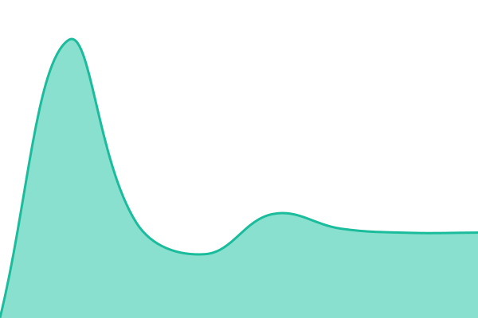 398ms
     
 | 

<a href="https://wokabout.github.io/pg-upptime/history/png-digicel">100.00%</a>
    

|  [PNG-Digicel-CellMoni](https://www.digicelpacific.com/cellmoni/pg) | 🟩 Up | [png-digicel-cell-moni.yml](https://github.com/wokabout/pg-upptime/commits/HEAD/history/png-digicel-cell-moni.yml) | 

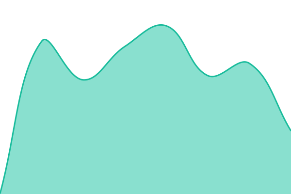 326ms
     
 | 

<a href="https://wokabout.github.io/pg-upptime/history/png-digicel-cell-moni">100.00%</a>
    

|  [PNG-Vodafone](https://vodafone.com.pg/) | 🟩 Up | [png-vodafone.yml](https://github.com/wokabout/pg-upptime/commits/HEAD/history/png-vodafone.yml) | 

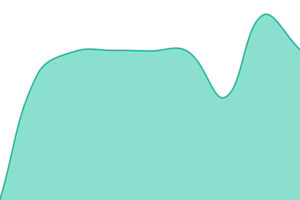 382ms
     
 | 

<a href="https://wokabout.github.io/pg-upptime/history/png-vodafone">100.00%</a>
    

|  [PNG-NAC](https://nac.com.pg/) | 🟩 Up | [png-nac.yml](https://github.com/wokabout/pg-upptime/commits/HEAD/history/png-nac.yml) | 

 1010ms
     
 | 

<a href="https://wokabout.github.io/pg-upptime/history/png-nac">100.00%</a>
    

|  [PNG-AirNiugini](https://www.airniugini.com.pg/) | 🟩 Up | [png-air-niugini.yml](https://github.com/wokabout/pg-upptime/commits/HEAD/history/png-air-niugini.yml) | 

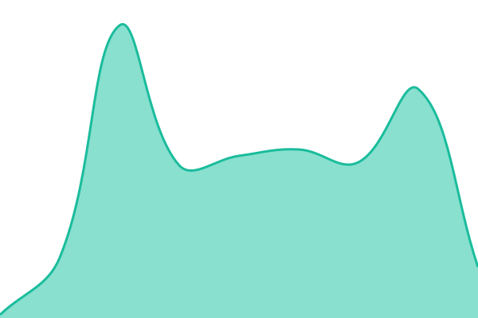 103ms
     
 | 

<a href="https://wokabout.github.io/pg-upptime/history/png-air-niugini">100.00%</a>
    

|  [PNG-Ports](https://www.pngports.com.pg/) | 🟩 Up | [png-ports.yml](https://github.com/wokabout/pg-upptime/commits/HEAD/history/png-ports.yml) | 

 1199ms
     
 | 

<a href="https://wokabout.github.io/pg-upptime/history/png-ports">95.19%</a>
    

<!--end: status pages-->

[**Visit our status website →**](https://wokabout.github.io/pg-upptime)

## 📄 License

- Powered by: [Upptime](https://github.com/upptime/upptime)
- Code: [MIT](./LICENSE) © [Anand Chowdhary](https://anandchowdhary.com)
- Data in the `./history` directory: [Open Database License](https://opendatacommons.org/licenses/odbl/1-0/)
